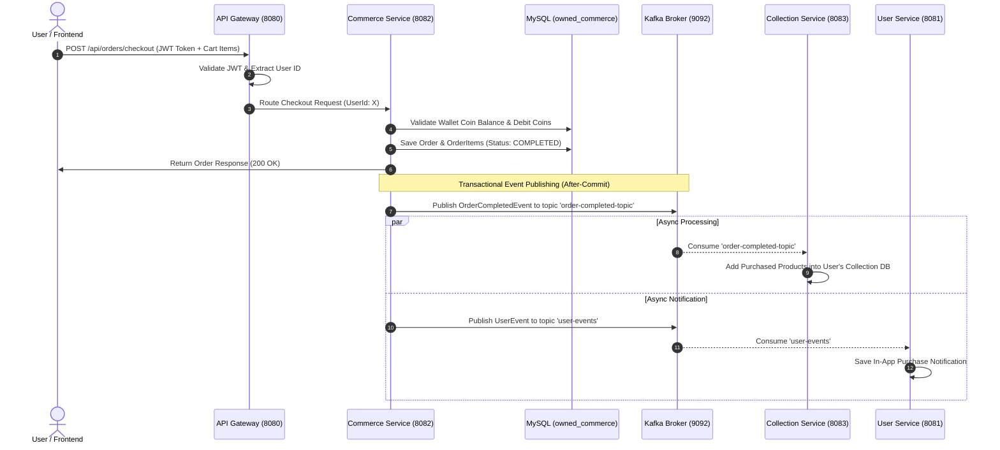

# 🏆 Owned OS – Microservices E-Commerce & Asset Management System

> 🌐 **Live Cloud URL**: [http://3.6.39.23/](http://3.6.39.23/)  
> 🐳 **Docker Hub Registry**: [`heavycoder`](https://hub.docker.com/u/heavycoder)  
> ☁️ **Cloud Host**: AWS EC2 (Single-Instance Containerized Microservices Architecture)

---

**Owned OS** is an enterprise-grade, event-driven e-commerce platform built with **Spring Boot Microservices**, **Apache Kafka**, **MySQL**, **Spring Cloud Gateway**, **Netflix Eureka Service Discovery**, and a modern **React + Vite** frontend inspired by top e-commerce platforms (Amazon, Flipkart, Myntra).


---

## 📌 1. Comprehensive High-Level Design (HLD)

### 1.1 Overall System Topology

The platform operates as a distributed event-driven microservices architecture. Client applications connect through a centralized **Spring Cloud API Gateway** which validates authentication tokens and routes requests dynamically using **Netflix Eureka Service Discovery**. Core domain logic is split across independent bounded contexts (**User**, **Commerce**, **Collection**), communicating synchronously via REST APIs and asynchronously via **Apache Kafka** event topics.


---

### 1.2 Microservice-by-Microservice High-Level Design (HLD)

---

#### 🔍 A. Service Discovery (`eureka-service`)
* **Port**: `8761`
* **Technology**: Spring Cloud Netflix Eureka Server
* **Purpose**: Serves as the central service registry for instance registration and dynamic service location lookup.

```
       +------------------------------------+
       |          Eureka Registry           |
       |  (Stores Service Name -> IP:Port)  |
       +------------------------------------+
           ▲            ▲            ▲
           │ Heartbeat  │ Heartbeat  │ Heartbeat
     [user-service] [commerce-service] [collection-service]
```

* **Core Responsibilities**:
  - Maintains real-time registry of all active microservice instances.
  - Enables client-side load balancing (`lb://user-service`, `lb://commerce-service`, etc.) without hardcoding hostnames.
  - Automatically handles health checks and evicts unresponsive service instances.
* **Inbound Interfaces**:
  - `GET /eureka/apps` – Registry status endpoint.
  - `http://localhost:8761` – Web Dashboard UI.
* **Dependencies**: None.

---

#### 🛡️ B. Edge API Gateway (`gateway`)
* **Port**: `8080`
* **Technology**: Spring Cloud Gateway (MVC Stack), Spring Security, JJWT
* **Purpose**: Single entry point for all client requests. Manages unified routing, request prefix stripping, CORS configuration, and JWT authentication verification.

```
[ Client Request ] ──► [ Gateway Filters ] ──► [ Eureka Lookup ] ──► [ Target Microservice ]
                         │ JWT Validation
                         │ Path Stripping
```

* **Core Responsibilities**:
  - **Dynamic Routing & Path Stripping**:
    - `/api/auth/**`, `/api/users/**` ──► `lb://user-service`
    - `/api/products/**`, `/api/orders/**`, `/api/wallet/**`, `/api/payments/**` ──► `lb://commerce-service`
    - `/api/collection/**`, `/api/certificates/**` ──► `lb://collection-service`
  - **Security & Authorization**: Validates incoming Authorization Bearer JWT signatures against a shared HMAC-SHA256 secret.
  - **CORS Handling**: Provides unified Cross-Origin Resource Sharing policy for web frontend origins (`http://localhost:5173`).
* **Dependencies**: `eureka-service` (for service resolution).

---

#### 👤 C. User Service (`user-service`)
* **Port**: `8081`
* **Database**: MySQL (`owned_users`)
* **Technology**: Spring Boot, Spring Security (BCrypt), JPA/Hibernate, Apache Kafka Client
* **Purpose**: Manages user identity, authentication, credential validation, user profile attributes, and real-time user notification logs.

```
  +-----------------------------------------------------------------------+
  |                             USER SERVICE                              |
  |  +--------------------+   +-------------------+   +----------------+  |
  |  | Authentication     |   | Profile Manager   |   | Notification   |  |
  |  | (JWT & Refresh)    |   | (User Attributes) |   | Consumer       |  |
  |  +--------------------+   +-------------------+   +----------------+  |
  +-----------------------------------------------------------------------+
            │                         │                       ▲
            ▼                         ▼                       │ Consume
     [ owned_users DB ]        [ owned_users DB ]      [ Kafka: user-events ]
```

* **Core Sub-Modules**:
  1. **Auth & Identity Manager**: Handles registration, BCrypt password hashing, login verification, access token generation, and refresh token rotation.
  2. **Profile Manager**: Manages user bio, avatars, display names, and preference settings.
  3. **Notification Consumer & Engine**: Listens to the `user-events` Kafka topic to store in-app notifications (e.g., purchase confirmations, system alerts).
* **Inbound Interfaces (REST)**:
  - `POST /auth/register`, `POST /auth/login`, `POST /auth/refresh`
  - `GET /users/profile`, `PUT /users/profile`
  - `GET /users/notifications`
* **Outbound Dependencies**: `owned_users` MySQL DB, Kafka Topic (`user-events`).

---

#### 🛒 D. Commerce Service (`commerce-service`)
* **Port**: `8082`
* **Database**: MySQL (`owned_commerce`)
* **Technology**: Spring Boot, Spring Data JPA, Apache Kafka Producer, Transactional Event Publisher
* **Purpose**: Core e-commerce engine handling catalog browsing, cart operations, checkout transactional workflows, digital wallet balances, and UPI/Payment integrations.

```
+-----------------------------------------------------------------------------------+
|                                 COMMERCE SERVICE                                  |
|  +-------------------+  +-------------------+  +------------------+  +---------+  |
|  | Catalog & Search  |  | Cart & Checkout   |  | Wallet System    |  | Payment |  |
|  | (Products/Cat.)   |  | (Order Creation)  |  | (Coins Ledger)   |  | (UPI)   |  |
|  +-------------------+  +-------------------+  +------------------+  +---------+  |
+-----------------------------------------------------------------------------------+
            │                       │                      │
            ▼                       ▼                      ▼
    [ owned_commerce DB ]   [ Transactional Event ] ──► [ Kafka: order-completed-topic ]
```

* **Core Sub-Modules**:
  1. **Catalog Engine**: Manages 150+ product listings across categories ranging from everyday essentials to ultra-luxury items.
  2. **Wallet Coins Ledger**: Maintains user coin balances (`coin_balance`) and transaction logs (`CREDIT`/`DEBIT`).
  3. **Order & Checkout Manager**: Executes atomic checkout operations—validates stock and coin balance, debits wallet, creates completed orders, and fires transactional domain events.
  4. **Payment Gateway Integration**: Simulates and manages UPI / Stripe / Razorpay payment order initiation and verification hooks.
  5. **Kafka Event Producer**: Publishes `OrderCompletedEvent` payloads to Kafka after DB transaction commit (`TransactionPhase.AFTER_COMMIT`).
* **Inbound Interfaces (REST)**:
  - `GET /products`, `GET /products/{id}`, `GET /categories`
  - `POST /orders/checkout`, `GET /orders`
  - `GET /wallet/balance`, `POST /wallet/add-coins`
  - `POST /payments/create-order`, `POST /payments/verify`
* **Outbound Dependencies**: `owned_commerce` MySQL DB, Kafka Topic (`order-completed-topic`, `user-events`).

---

#### 📦 E. Collection Service (`collection-service`)
* **Port**: `8083`
* **Database**: MySQL (`owned_collection`)
* **Technology**: Spring Boot, Spring Data JPA, Apache Kafka Listener, Jackson JSON
* **Purpose**: Manages the user's digital asset vault and collection library. Consumes asynchronous order completion events from Kafka to automatically credit purchased items to the buyer's collection.

```
                  +-----------------------------------------+
                  |           COLLECTION SERVICE            |
                  |  +-------------------+  +------------+  |
                  |  | Kafka Consumer    |  | Asset Vault|  |
                  |  | (order-completed) |  | REST API   |  |
                  |  +-------------------+  +------------+  |
                  +-----------------------------------------+
                                 ▲                 │
                         Consume │                 ▼
        [ Kafka: order-completed-topic ]    [ owned_collection DB ]
```

* **Core Sub-Modules**:
  1. **Order Consumer Listener**: `@KafkaListener` consuming messages on `order-completed-topic`. Translates order items into collection asset entries.
  2. **Collection Vault Engine**: Manages collection cataloging, item ownership lookup, and acquisition history tracking.
* **Inbound Interfaces (REST)**:
  - `GET /collection` – Get logged-in user's collection items.
  - `GET /collection/{itemId}` – Get item details.
* **Outbound Dependencies**: `owned_collection` MySQL DB, Kafka Topic (`order-completed-topic`).

---

#### 📱 F. Owned Frontend (`owned-frontend`)
* **Port**: `5173`
* **Technology**: React 18, Vite, Modern CSS (Glassmorphism), Lucide React Icons
* **Purpose**: Modern, responsive e-commerce web application inspired by Amazon, Flipkart, and Myntra.

```
┌────────────────────────────────────────────────────────────────────────┐
│                        OWNED FRONTEND UI                               │
│ ┌──────────────┐ ┌──────────────┐ ┌───────────────┐ ┌────────────────┐ │
│ │ Navbar & Auth│ │ Hero Banners │ │ Product Grid  │ │ Cart Drawer    │ │
│ └──────────────┘ └──────────────┘ └───────────────┘ └────────────────┘ │
│ ┌──────────────┐ ┌──────────────┐ ┌───────────────┐ ┌────────────────┐ │
│ │ Product Modal│ │ UPI Checkout │ │ Leaderboard   │ │ Collection View│ │
│ └──────────────┘ └──────────────┘ └───────────────┘ └────────────────┘ │
└────────────────────────────────────────────────────────────────────────┘
```

* **Core User Flows**:
  - **Browsing & Search**: Search products, filter by category/tier, view product details.
  - **Cart & Wallet Checkout**: Manage cart items, inspect coin balance, complete instant coin checkout or UPI payment.
  - **User Collection Library**: View personal digital asset collection immediately after checkout.
* **Dependencies**: API Gateway (`http://localhost:8080`).

---

#### ⚡ G. Event Streaming Infrastructure (`Kafka + KRaft`)
* **Ports**: `9092` (Host App Broker), `29092` (Internal Container Network), `8090` (Kafka UI)
* **Technology**: Confluent Kafka (`cp-kafka:7.7.0`) in KRaft Mode + Provectus Kafka UI
* **Purpose**: Decouples microservice workloads by providing high-throughput, fault-tolerant asynchronous event channels.

* **Kafka Topics Summary**:
  1. `order-completed-topic` (3 Partitions, Replication 1): Published by `commerce-service` when an order is completed; consumed by `collection-service` for asset fulfillment.
  2. `user-events` (3 Partitions, Replication 1): Published on user activities; consumed by `user-service` to log user notifications.

---

## 🔍 2. Low-Level Design (LLD)

### Database Schemas & Entities

```
+-----------------------------------------------------------------------------------+
|                                 DATABASE SCHEMAS                                  |
+-----------------------------------------------------------------------------------+
|  [owned_users]            [owned_commerce]                   [owned_collection]   |
|  ├─ users                 ├─ categories                      ├─ user_collections  |
|  ├─ user_profiles         ├─ products                        └─ collection_items  |
|  ├─ refresh_tokens        ├─ orders                                               |
|  └─ notifications         ├─ order_items                                          |
|                           ├─ wallets                                              |
|                           └─ wallet_transactions                                  |
+-----------------------------------------------------------------------------------+
```

1. **`owned_users` (User Service)**
   - `users`: `id`, `username`, `email`, `password_hash`, `role`, `created_at`, `updated_at`
   - `user_profiles`: `id`, `user_id`, `full_name`, `avatar_url`, `phone_number`
   - `refresh_tokens`: `id`, `user_id`, `token`, `expiry_date`
   - `notifications`: `id`, `user_id`, `type` (PURCHASE/FOLLOW/SYSTEM), `payload_json`, `is_read`, `created_at`

2. **`owned_commerce` (Commerce Service)**
   - `categories`: `id`, `name`, `tier` (EVERYDAY/LUXURY/ULTRA), `parent_id`
   - `products`: `id`, `category_id`, `name`, `description`, `image_url`, `price_coins`, `is_active`
   - `orders`: `id`, `user_id`, `total_coins`, `status` (PENDING/COMPLETED/CANCELLED), `created_at`
   - `order_items`: `id`, `order_id`, `product_id`, `price_at_purchase`
   - `wallets`: `id`, `user_id`, `coin_balance`, `updated_at`
   - `wallet_transactions`: `id`, `wallet_id`, `amount`, `type` (CREDIT/DEBIT), `reference_id`, `description`, `created_at`

3. **`owned_collection` (Collection Service)**
   - `user_collections`: `id`, `user_id`, `created_at`
   - `collection_items`: `id`, `collection_id`, `product_id`, `product_name`, `product_image`, `acquired_at`, `source_order_id`

---

### Event-Driven Architecture & Message Flow

#### Order Processing & Asset Fulfillment Sequence



---

## 🛠️ 3. Prerequisites

Make sure you have the following installed on your machine:

1. **Java Development Kit (JDK 17 or 21 LTS)**
2. **Apache Maven 3.8+**
3. **Node.js (v18+) & npm**
4. **Docker Desktop** (for running Kafka & Kafka UI)
5. **MySQL Server 8.0+** running locally on port `3306`

---

## 🚀 4. How to Run the Complete Application

### Step 1: Start Apache Kafka & Kafka UI via Docker

Kafka is configured in single-node **KRaft mode** (no Zookeeper required).

Open a terminal in the project root directory (`d:\V\Project\13_Owned`) and run:

```bash
# Start Kafka and Kafka UI containers in background
docker compose up -d
```

#### Verifying Docker Containers:
```bash
docker ps
```
You should see:
- `owned-kafka` running on port `9092`
- `owned-kafka-ui` running on port `8090`

#### Access Kafka UI:
Open `http://localhost:8090` in your web browser to monitor topics and consumer groups.

#### Useful Docker Kafka CLI Commands:
```bash
# List all topics
docker exec -it owned-kafka kafka-topics --bootstrap-server localhost:9092 --list

# Manually create a topic (if needed)
docker exec -it owned-kafka kafka-topics --bootstrap-server localhost:9092 --create --topic order-completed-topic --partitions 3 --replication-factor 1

# Inspect messages in order-completed-topic
docker exec -it owned-kafka kafka-console-consumer --bootstrap-server localhost:9092 --topic order-completed-topic --from-beginning

# Inspect messages in user-events topic
docker exec -it owned-kafka kafka-console-consumer --bootstrap-server localhost:9092 --topic user-events --from-beginning
```

---

### Step 2: Set up Local MySQL Databases & Seed Data

Ensure your local MySQL server is running on port `3306` with credentials:
- **Username**: `root`
- **Password**: `root`

The Spring Boot applications are configured with `createDatabaseIfNotExist=true` and will automatically create the required databases:
- `owned_users`
- `owned_commerce`
- `owned_collection`

#### Seed 150 Products into Commerce Service:
Run the seed script against `owned_commerce`:

**On Windows PowerShell / CMD:**
```powershell
mysql -u root -proot owned_commerce < seed_150_products.sql
```

*(Or open `seed_150_products.sql` in MySQL Workbench / DBeaver and execute it against `owned_commerce`)*.

---

### Step 3: Start Spring Boot Microservices

Start the backend services in separate terminal windows **in the following order**:

#### 1. Start Eureka Discovery Service (Port 8761)
```bash
cd eureka-service
mvn spring-boot:run
```
> Verify: Open `http://localhost:8761` in your browser.

#### 2. Start API Gateway (Port 8080)
```bash
cd gateway
mvn spring-boot:run
```

#### 3. Start User Service (Port 8081)
```bash
cd user-service
mvn spring-boot:run
```

#### 4. Start Commerce Service (Port 8082)
```bash
cd commerce-service
mvn spring-boot:run
```

#### 5. Start Collection Service (Port 8083)
```bash
cd collection-service
mvn spring-boot:run
```

---

### Step 4: Start Frontend Application (Port 5173)

Open a terminal window and navigate to `owned-frontend`:

```bash
cd owned-frontend

# Install dependencies
npm install

# Start development server
npm run dev
```

> **Access Application**: Open `http://localhost:5173` in your browser.

---

## 🚀 5. AWS EC2 Cloud Deployment Architecture

The entire platform is containerized and hosted live on **AWS EC2**, orchestrated via Docker Compose with JVM-tuned microservices and an Nginx reverse proxy.

* **Live Platform URL**: [http://3.6.39.23/](http://3.6.39.23/)
* **Docker Hub Registry**: [`hub.docker.com/u/heavycoder`](https://hub.docker.com/u/heavycoder)
* **Security Group Configuration**: Only **Port 80 (HTTP)** and **Port 22 (SSH)** are exposed to the internet. All internal microservices, Eureka, Kafka, and MySQL communicate purely over the internal Docker bridge network.

```
                      INTERNET / WEB BROWSER
                                │
                      ┌─────────▼─────────┐
                      │  AWS EC2 Instance │
                      │  (IP: 3.6.39.23)  │
                      └─────────┬─────────┘
                                │
                 ┌──────────────▼──────────────┐
                 │    Nginx (Port 80 / HTTP)   │
                 └──────┬───────────────┬──────┘
                        │               │
         Static Assets  │               │ Requests to `/api/**`
        (React 19 SPA)  │               │
    ┌───────────────────▼──┐     ┌──────▼────────┐
    │ owned-frontend       │     │ gateway:8080  │
    └──────────────────────┘     └──────┬────────┘
                                        │
                         ┌──────────────┴──────────────┐
                         │ Dynamic Routing via Eureka  │
                         │                             ▼
           ┌─────────────┼──────────────┐      ┌───────────────┐
           │             │              │      │ eureka:8761   │
           ▼             ▼              ▼      │ Service Reg.  │
    ┌─────────────┐┌─────────────┐┌────────────┤               │
    │user-service ││commerce-serv││collection- │└───────────────┘
    │ (port 8081) ││ (port 8082) ││service:8083│
    └──────┬──────┘└──────┬──────┘└─────┬──────┘
           │              │             │
           ├──────────────┴─────────────┤
           │  Docker Internal Network   │
           ▼                            ▼
    ┌──────────────┐             ┌──────────────┐
    │ mysql:3306   │             │ kafka:29092  │
    │ (3 Databases)│             │ (KRaft Mode) │
    └──────────────┘             └──────────────┘
```

---

### 5.1 Docker Hub Image Registry

All 6 custom application images are pre-built for `linux/amd64` architecture and maintained on Docker Hub:

| Service | Docker Hub Image | Responsibilities & Port |
| :--- | :--- | :--- |
| **Service Discovery** | `heavycoder/owned-eureka:latest` | Netflix Eureka Registry (`8761`) |
| **API Gateway** | `heavycoder/owned-gateway:latest` | Edge Routing & Security (`8080`) |
| **User Service** | `heavycoder/owned-user-service:latest` | Auth, Users & Profiles (`8081`) |
| **Commerce Service** | `heavycoder/owned-commerce-service:latest` | Catalog, Orders, Wallet (`8082`) |
| **Collection Service**| `heavycoder/owned-collection-service:latest` | Digital Assets & Library (`8083`) |
| **Frontend UI** | `heavycoder/owned-frontend:latest` | React + Vite served via Nginx (`80`) |

---

### 5.2 EC2 Sizing & JVM Memory Optimization

To run 5 Spring Boot microservices, Kafka KRaft, MySQL, and Nginx on a single EC2 instance without triggering out-of-memory crashes, strict memory allocations are enforced:

| Container | Memory Limit / Heap Setting | Role |
| :--- | :--- | :--- |
| **User Service** | `-Xms256m -Xmx384m` | Spring Boot JPA Service |
| **Commerce Service** | `-Xms256m -Xmx384m` | Spring Boot JPA Service |
| **Collection Service** | `-Xms256m -Xmx384m` | Spring Boot JPA Service |
| **Gateway** | `-Xms192m -Xmx256m` | Spring Cloud Gateway MVC |
| **Eureka** | `-Xms192m -Xmx256m` | Service Registry |
| **Kafka (KRaft)** | `-Xms512m -Xmx768m` | Single-node Event Broker |
| **MySQL 8.0** | `--innodb-buffer-pool-size=512M` | Multi-Schema Database |
| **Frontend** | ~20 MB (Nginx Alpine) | Static Asset Server & Proxy |
| **Total Memory** | **~6 GB – 8 GB RAM** | Fits comfortably on `t3.large` / `t4g.large` |

---

### 5.3 Step-by-Step EC2 Deployment Guide

#### 1. Build and Push Images from Local Machine
Using the included automated scripts:
```cmd
# Windows (PowerShell / Command Prompt)
push-to-dockerhub.bat

# Linux / macOS / WSL
./push-to-dockerhub.sh
```

#### 2. Launch on EC2
On the EC2 VM (in `~/owned` directory):
```bash
# Pull the latest prebuilt images from Docker Hub (~30 seconds)
docker compose -f docker-compose.prod.yml pull

# Start the full platform
docker compose -f docker-compose.prod.yml up -d

# Verify all containers are healthy
docker compose -f docker-compose.prod.yml ps
```

#### 3. Seed Catalog Products
Seed the catalog with 150+ products inside the MySQL container:
```bash
docker exec -i owned-mysql mysql -u root -proot owned_commerce < seed_150_products.sql
```

#### 4. Access Live Platform
Open your browser and navigate to:
```text
http://3.6.39.23/
```

---

## 🌐 6. Key API Endpoints & Routes

All external API requests must be routed through the **API Gateway** (`http://localhost:8080`).

### 🔑 Authentication & Users (`/api/auth/**`, `/api/users/**`)
- `POST /api/auth/register` – Register a new user
- `POST /api/auth/login` – Login & receive JWT Access + Refresh Tokens
- `POST /api/auth/refresh` – Refresh expired access token
- `GET /api/users/profile` – Fetch current user profile (Requires Bearer Token)
- `GET /api/users/notifications` – Fetch user notifications (Requires Bearer Token)

### 🛒 Commerce & Products (`/api/products/**`, `/api/orders/**`, `/api/wallet/**`, `/api/payments/**`)
- `GET /api/products` – List all products with filtering & pagination
- `GET /api/products/{id}` – Get product details
- `POST /api/orders/checkout` – Checkout cart items using wallet coins
- `GET /api/orders` – Get order history for user
- `GET /api/wallet/balance` – Get current coin balance
- `POST /api/wallet/add-coins` – Top-up wallet coins
- `POST /api/payments/create-order` – Initialize payment order (UPI / Card)
- `POST /api/payments/verify` – Verify UPI payment signature / transaction

### 📦 User Collection (`/api/collections/**`)
- `GET /api/collection` – Fetch user's owned asset library
- `GET /api/collection/{itemId}` – Fetch detailed view of an owned item

---

## 📂 7. Postman API Collections

Pre-built Postman collections are included in the repository root for immediate testing:
- [Owned_OS_Postman_Collection.json](file:///d:/V/Project/13_Owned/Owned_OS_Postman_Collection.json)
- [owned_api_collection.json](file:///d:/V/Project/13_Owned/owned_api_collection.json)

---

## ⚡ 8. Troubleshooting & FAQ

- **Kafka Connection Refused (`localhost:9092`)**: Make sure `docker compose up -d` was executed and container `owned-kafka` status shows `healthy`.
- **Database Connection Failure**: Ensure local MySQL is running on `3306` with user `root` and password `root`.
- **Eureka Service Registration**: Wait ~10–15 seconds after starting each service for it to register with Eureka before hitting Gateway routes.
