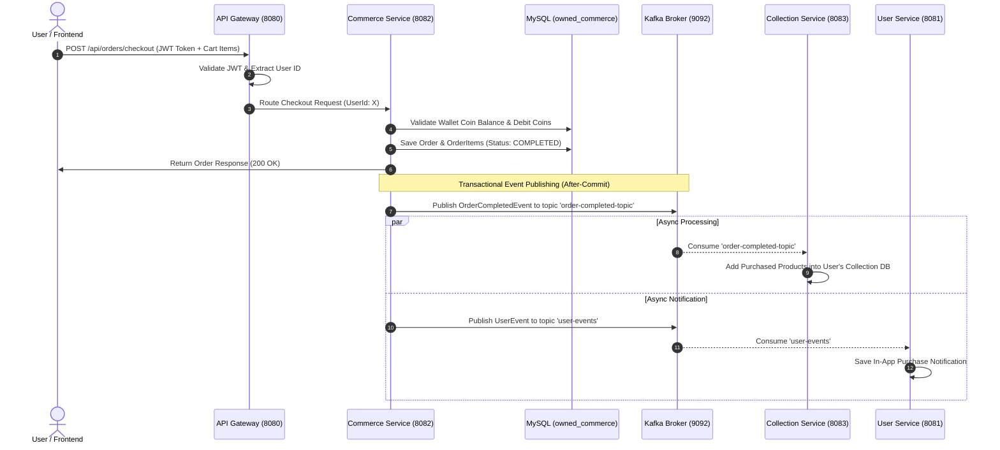

# 🏆 Owned OS – Microservices E-Commerce & Asset Management System

**Owned OS** is an enterprise-grade, event-driven e-commerce platform built with **Spring Boot Microservices**, **Apache Kafka**, **MySQL**, **Spring Cloud Gateway**, **Netflix Eureka Service Discovery**, and a modern **React + Vite** frontend inspired by top e-commerce platforms (Amazon, Flipkart, Myntra).

---

## 📌 1. High-Level Architecture (HLD)

The platform follows a distributed microservices architecture where client requests route through a single entry point (API Gateway), authenticated via JWTs, and synchronized asynchronously using Kafka event streaming.

```mermaid
flowchart TB
    subgraph Client Layer
        FE["📱 Owned Frontend (React + Vite)\nhttp://localhost:5173"]
    end

    subgraph Edge & Discovery Layer
        EUREKA["🔍 Eureka Service Registry\n(port 8761)"]
        GW["🛡️ Spring Cloud Gateway\n(port 8080)"]
    end

    subgraph Microservices Layer
        USER["👤 User Service\n(port 8081)"]
        COMMERCE["🛒 Commerce Service\n(port 8082)"]
        COLLECTION["📦 Collection Service\n(port 8083)"]
    end

    subgraph Event Streaming & Messaging
        KAFKA["⚡ Apache Kafka Broker (KRaft)\n(port 9092 / 29092)"]
        KAFKA_UI["📊 Kafka UI Dashboard\nhttp://localhost:8090"]
    end

    subgraph Persistence Layer (Local MySQL)
        DB_USER[("🗄️ owned_users")]
        DB_COMMERCE[("🗄️ owned_commerce")]
        DB_COLLECTION[("🗄️ owned_collection")]
    end

    %% Communications
    FE -->|HTTP / REST| GW
    GW <-->|Service Discovery| EUREKA
    USER <-->|Register with Eureka| EUREKA
    COMMERCE <-->|Register with Eureka| EUREKA
    COLLECTION <-->|Register with Eureka| EUREKA

    GW -->|/api/auth/**, /api/users/**| USER
    GW -->|/api/products/**, /api/orders/**, /api/wallet/**, /api/payments/**| COMMERCE
    GW -->|/api/collections/**| COLLECTION

    USER --> DB_USER
    COMMERCE --> DB_COMMERCE
    COLLECTION --> DB_COLLECTION

    COMMERCE -->|Publish: order-completed-topic| KAFKA
    COLLECTION -->|Consume: order-completed-topic| KAFKA
    USER -->|Consume: user-events| KAFKA
    KAFKA_UI -.->|Monitor| KAFKA
```

### Microservices Breakdown

| Service | Port | Database | Primary Responsibility |
| :--- | :--- | :--- | :--- |
| **eureka-service** | `8761` | N/A | Service Discovery Registry. Registers all microservices for dynamic routing and load balancing. |
| **gateway** | `8080` | N/A | Edge API Gateway. Handles JWT validation, rate limiting, and request routing to downstream microservices. |
| **user-service** | `8081` | `owned_users` | Manages user registration, login, JWT token issuance/refresh, user profiles, and in-app notifications. |
| **commerce-service**| `8082` | `owned_commerce` | Handles product catalog, categories, cart management, checkout logic, wallet coins, UPI payment gateway integration, and publishes checkout events. |
| **collection-service**| `8083` | `owned_collection` | Digital asset / user collection library. Consumes order events from Kafka to automatically credit purchased items into the user's personal collection. |
| **owned-frontend** | `5173` | N/A | Single Page Application (SPA) built with React, Vite, Lucide Icons, and Tailwind CSS. |
| **Kafka (Docker)** | `9092` | N/A | High-throughput asynchronous event streaming broker (KRaft mode). |
| **Kafka UI (Docker)**| `8090` | N/A | Web UI management console for inspecting Kafka topics, consumer groups, and messages. |

---

## 🔍 2. Low-Level Design (LLD)

### Database Schemas & Entities

```
+-----------------------------------------------------------------------------------+
|                                 DATABASE SCHEMAS                                  |
+-----------------------------------------------------------------------------------+
|  [owned_users]            [owned_commerce]                   [owned_collection]   |
|  ├─ users                 ├─ categories                      ├─ user_collections  |
|  ├─ user_profiles         ├─ products                        └─ collection_items  |
|  ├─ refresh_tokens        ├─ orders                                               |
|  └─ notifications         ├─ order_items                                          |
|                           ├─ wallets                                              |
|                           └─ wallet_transactions                                  |
+-----------------------------------------------------------------------------------+
```

1. **`owned_users` (User Service)**
   - `users`: `id`, `username`, `email`, `password_hash`, `role`, `created_at`, `updated_at`
   - `user_profiles`: `id`, `user_id`, `full_name`, `avatar_url`, `phone_number`
   - `refresh_tokens`: `id`, `user_id`, `token`, `expiry_date`
   - `notifications`: `id`, `user_id`, `type` (PURCHASE/FOLLOW/SYSTEM), `payload_json`, `is_read`, `created_at`

2. **`owned_commerce` (Commerce Service)**
   - `categories`: `id`, `name`, `tier` (EVERYDAY/LUXURY/ULTRA), `parent_id`
   - `products`: `id`, `category_id`, `name`, `description`, `image_url`, `price_coins`, `is_active`
   - `orders`: `id`, `user_id`, `total_coins`, `status` (PENDING/COMPLETED/CANCELLED), `created_at`
   - `order_items`: `id`, `order_id`, `product_id`, `price_at_purchase`
   - `wallets`: `id`, `user_id`, `coin_balance`, `updated_at`
   - `wallet_transactions`: `id`, `wallet_id`, `amount`, `type` (CREDIT/DEBIT), `reference_id`, `description`, `created_at`

3. **`owned_collection` (Collection Service)**
   - `user_collections`: `id`, `user_id`, `created_at`
   - `collection_items`: `id`, `collection_id`, `product_id`, `product_name`, `product_image`, `acquired_at`, `source_order_id`

---

### Event-Driven Architecture & Message Flow

#### Order Processing & Asset Fulfillment Sequence



---

## 🛠️ 3. Prerequisites

Make sure you have the following installed on your machine:

1. **Java Development Kit (JDK 17 or 21 LTS)**
2. **Apache Maven 3.8+**
3. **Node.js (v18+) & npm**
4. **Docker Desktop** (for running Kafka & Kafka UI)
5. **MySQL Server 8.0+** running locally on port `3306`

---

## 🚀 4. How to Run the Complete Application

### Step 1: Start Apache Kafka & Kafka UI via Docker

Kafka is configured in single-node **KRaft mode** (no Zookeeper required).

Open a terminal in the project root directory (`d:\V\Project\13_Owned`) and run:

```bash
# Start Kafka and Kafka UI containers in background
docker compose up -d
```

#### Verifying Docker Containers:
```bash
docker ps
```
You should see:
- `owned-kafka` running on port `9092`
- `owned-kafka-ui` running on port `8090`

#### Access Kafka UI:
Open `http://localhost:8090` in your web browser to monitor topics and consumer groups.

#### Useful Docker Kafka CLI Commands:
```bash
# List all topics
docker exec -it owned-kafka kafka-topics --bootstrap-server localhost:9092 --list

# Manually create a topic (if needed)
docker exec -it owned-kafka kafka-topics --bootstrap-server localhost:9092 --create --topic order-completed-topic --partitions 3 --replication-factor 1

# Inspect messages in order-completed-topic
docker exec -it owned-kafka kafka-console-consumer --bootstrap-server localhost:9092 --topic order-completed-topic --from-beginning

# Inspect messages in user-events topic
docker exec -it owned-kafka kafka-console-consumer --bootstrap-server localhost:9092 --topic user-events --from-beginning
```

---

### Step 2: Set up Local MySQL Databases & Seed Data

Ensure your local MySQL server is running on port `3306` with credentials:
- **Username**: `root`
- **Password**: `root`

The Spring Boot applications are configured with `createDatabaseIfNotExist=true` and will automatically create the required databases:
- `owned_users`
- `owned_commerce`
- `owned_collection`

#### Seed 150 Products into Commerce Service:
Run the seed script against `owned_commerce`:

**On Windows PowerShell / CMD:**
```powershell
mysql -u root -proot owned_commerce < seed_150_products.sql
```

*(Or open `seed_150_products.sql` in MySQL Workbench / DBeaver and execute it against `owned_commerce`)*.

---

### Step 3: Start Spring Boot Microservices

Start the backend services in separate terminal windows **in the following order**:

#### 1. Start Eureka Discovery Service (Port 8761)
```bash
cd eureka-service
mvn spring-boot:run
```
> Verify: Open `http://localhost:8761` in your browser.

#### 2. Start API Gateway (Port 8080)
```bash
cd gateway
mvn spring-boot:run
```

#### 3. Start User Service (Port 8081)
```bash
cd user-service
mvn spring-boot:run
```

#### 4. Start Commerce Service (Port 8082)
```bash
cd commerce-service
mvn spring-boot:run
```

#### 5. Start Collection Service (Port 8083)
```bash
cd collection-service
mvn spring-boot:run
```

---

### Step 4: Start Frontend Application (Port 5173)

Open a terminal window and navigate to `owned-frontend`:

```bash
cd owned-frontend

# Install dependencies
npm install

# Start development server
npm run dev
```

> **Access Application**: Open `http://localhost:5173` in your browser.

---

## 🌐 5. Key API Endpoints & Routes

All external API requests must be routed through the **API Gateway** (`http://localhost:8080`).

### 🔑 Authentication & Users (`/api/auth/**`, `/api/users/**`)
- `POST /api/auth/register` – Register a new user
- `POST /api/auth/login` – Login & receive JWT Access + Refresh Tokens
- `POST /api/auth/refresh` – Refresh expired access token
- `GET /api/users/profile` – Fetch current user profile (Requires Bearer Token)
- `GET /api/users/notifications` – Fetch user notifications (Requires Bearer Token)

### 🛒 Commerce & Products (`/api/products/**`, `/api/orders/**`, `/api/wallet/**`, `/api/payments/**`)
- `GET /api/products` – List all products with filtering & pagination
- `GET /api/products/{id}` – Get product details
- `POST /api/orders/checkout` – Checkout cart items using wallet coins
- `GET /api/orders` – Get order history for user
- `GET /api/wallet/balance` – Get current coin balance
- `POST /api/wallet/add-coins` – Top-up wallet coins
- `POST /api/payments/create-order` – Initialize payment order (UPI / Card)
- `POST /api/payments/verify` – Verify UPI payment signature / transaction

### 📦 User Collection (`/api/collections/**`)
- `GET /api/collections` – Fetch user's owned asset library
- `GET /api/collections/{itemId}` – Fetch detailed view of an owned item

---

## 📂 6. Postman API Collections

Pre-built Postman collections are included in the repository root for immediate testing:
- [Owned_OS_Postman_Collection.json](file:///d:/V/Project/13_Owned/Owned_OS_Postman_Collection.json)
- [owned_api_collection.json](file:///d:/V/Project/13_Owned/owned_api_collection.json)

---

## ⚡ 7. Troubleshooting & FAQ

- **Kafka Connection Refused (`localhost:9092`)**: Make sure `docker compose up -d` was executed and container `owned-kafka` status shows `healthy`.
- **Database Connection Failure**: Ensure local MySQL is running on `3306` with user `root` and password `root`.
- **Eureka Service Registration**: Wait ~10–15 seconds after starting each service for it to register with Eureka before hitting Gateway routes.
